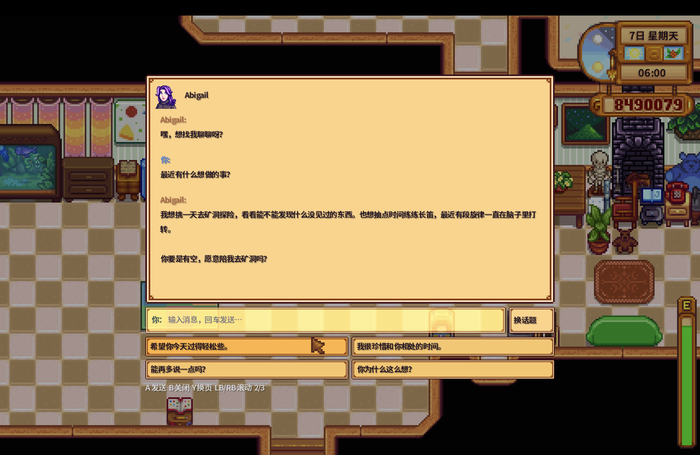
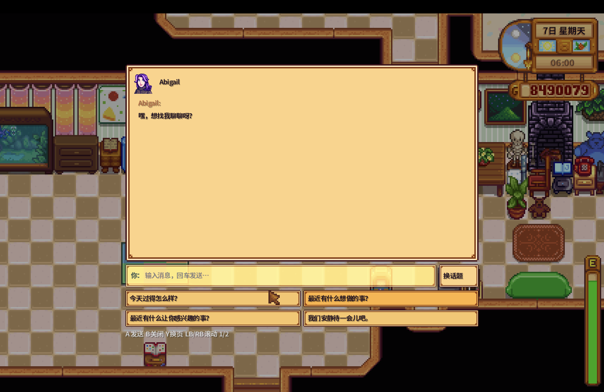

# SV_SOUL

[中文](README.md) · [English](README_EN.md)


*AI-generated feature concept illustration. Actual in-game screenshots appear below.*

An AI NPC mod for Stardew Valley. Characters respond using individual personalities, relationships, save-scoped memories, current game state, and relevant background knowledge.

Source version: **1.7.0**. Targets Stardew Valley 1.6; builds were verified against game 1.6.15 and SMAPI 4.5.2.

## See it in action

| Core experience | What it brings to play |
|---|---|
| Individual personalities | NPCs retain their interests, opinions, and voices. They can share wishes, disagree, or invite you to spend time together. |
| Shared memories | Conversations and evidence-backed memories follow your save. Reopen chat to continue or revisit earlier messages. |
| A shared world | Replies reflect relationships, weather, festivals, and the current situation, with relevant knowledge retrieved as needed. |
| Conversation without typing | Choose topics and follow-ups with a controller or mouse, and switch to free-form text whenever you like. |

### A character with plans of her own



Asked what she would like to do, Abigail shares her interests and wishes, then invites the player along. Invitations are conversational expressions; in-game actions remain player-controlled.

### Controller-friendly quick replies



Start with a question about the day, an interest, or simply spending a quiet moment together. Use the D-pad or left stick to select, A to send, Y to change pages, and LB/RB to scroll. Free-form text remains available.

*These unaltered screenshots were captured during the 1.6-stage validation on November 6, 2026. For 1.7 memory and background retrieval, see the [background guide](docs/history-and-lore.md) and [validation scope](docs/lore-validation.md).*

## Features

- 48 character profiles with distinct romance, social, child, and roommate boundaries.
- Conversation history and memories scoped to the save, player, and NPC. Memories follow normal game saving and roll back when exiting without saving. Currently supports single-player and the multiplayer host.
- Current relationships, residence, weather, time, birthdays, and festivals take precedence over older background.
- 107 bundled background cards plus facts from effective game assets. The tested vanilla 1.6.15 corpus contains 509 entries, including 329 common item descriptions and 12 festival calendars.
- Local Lucene.NET retrieval with character knowledge and disclosure conditions. At most three snippets and 1,000 characters per request; indexing runs in the background with no additional model calls.
- Reopened conversation history, paged scrolling, shared pending requests, and local quick replies for controller users.
- OpenAI-compatible Chat Completions and Anthropic Messages support.

## Install and configure

1. Install the game and [SMAPI](https://smapi.io/). The verified combination is game 1.6.15 / SMAPI 4.5.2.
2. Obtain a matching build or build `main` below. The independent `release` branch has its own version; check its `manifest.json`.
3. Exit the game and extract the `SV_SOUL` folder into the game's `Mods/` directory.
4. Copy [config.openai.example.json](config.openai.example.json) to `Mods/SV_SOUL/config.json`, then set your key, endpoint, and model.
5. Launch through SMAPI.

```json
{
  "ApiProvider": "OpenAI",
  "ApiKey": "YOUR_API_KEY",
  "BaseUrl": "https://api.openai.com/v1",
  "Model": "YOUR_MODEL_ID",
  "UseMaxCompletionTokens": true,
  "SendTemperature": true,
  "MaxTokens": 200,
  "Language": "en"
}
```

Use a model supported by your provider. `BaseUrl` accepts a service root, `/v1` prefix, or complete `/chat/completions` endpoint. For other version prefixes, provide the full endpoint. Set `UseMaxCompletionTokens=false` for providers requiring `max_tokens`, and `SendTemperature=false` when temperature is unsupported.

For Anthropic, set `ApiProvider="Anthropic"` and a suitable model. `BaseUrl=null` selects the default provider endpoint. Anthropic remains the code default for older configurations. Conversations are sent to the configured API service.

Preserve your configuration and game saves when updating, and exit the game before replacing files. Keep keys, player data, and game assets out of Git.

## Controls

Hold **Left Alt / Option** while interacting with social or service NPCs to open AI chat; normal interaction retains shops and quests. Romance characters use normal interaction according to their profile. Press **Y** on a controller to chat with a nearby NPC. Game appearance, event, and language requirements still apply.

| Action | Keyboard / mouse | Controller |
|---|---|---|
| Send typed text | Enter | X sends an existing draft |
| Select a quick reply | Click; Tab then arrows | D-pad / left stick |
| Send selected reply | Enter / click | A |
| Next quick-reply page | Space in choices / page button | Y |
| Scroll history | Wheel | LB/RB or right stick up/down |
| Close | Esc | B |

Quick replies are generated locally. `ControllerChatButton` changes the opening button.

## Configuration

| Setting | Default | Purpose |
|---|---|---|
| `EnabledNPCs` | `["*"]` | All NPCs, or an internal-ID allowlist |
| `ExcludedNPCs` | `[]` | Excluded NPC IDs |
| `SocialChatKey` | `LeftAlt` | Social AI interaction modifier |
| `ControllerChatButton` | `ControllerY` | Controller opening button |
| `TriggerKey` | `null` | Optional additional interaction modifier |
| `MaxHistoryTurns` | `8` | Recent model conversation limit; separate from UI history |
| `MaxTokens` | `200` | Reply token limit |
| `Temperature` | `0.9` | Sent when enabled and supported |
| `Language` | `zh` | Default reply language |
| `EnableTestBridge` | `false` | Developer game-control test bridge |
| `DebugMode` | `false` | Debug logging |

See [ModConfig.cs](Config/ModConfig.cs) for all fields and [memory lifecycle](docs/memory-lifecycle.md) for legacy imports.

## Build and test

Requires .NET 6 SDK and legally installed game assemblies with SMAPI.

```bash
git clone https://github.com/JamesRaoXiaoJian/SV_Soul.git
cd SV_Soul
dotnet build -c Release -p:GamePath="/path/to/Stardew Valley" -p:EnableModDeploy=false
```

The DLL and versioned ZIP are written to `bin/Release/net6.0/`. Disabling deployment keeps builds from changing the game installation.

Offline checks:

```bash
dotnet run --project tests/Core
python3 scripts/validate-lore-corpus.py
```

The optional `--native-lore` suite requires locally extracted game fixtures. See the [background guide](docs/history-and-lore.md). API scripts use a supplied local configuration and incur API usage. The developer test bridge can control the game and must be explicitly enabled.

Version 1.7.0 passed **467 offline checks and 91/91 labelled retrieval queries** on Linux, Windows, and macOS ARM64. Warm retrieval P95 over 10,000 synthetic entries was 0.190, 0.066, and 0.088 ms respectively. These measure retrieval, not model response time. This round did not launch the game or validate its UI; see [validation](docs/lore-validation.md).

## Repository

- `Agents/`: conversations, API requests, and game-state capture.
- `Models/`: personalities, relationship rules, voice, and quick replies.
- `Storage/`: save memories, knowledge records, and indexes.
- `UI/`: chat window, text input, and controller handling.
- `assets/personalities/` and `assets/lore/`: profiles and attributed knowledge.
- `tests/`, `scripts/`, and `docs/`: tests, utilities, and design/validation notes.

Game files, local tools, build caches, and most runtime artifacts stay local. Only selected public retrieval evidence is tracked. Start with the [documentation index](docs/README.md).

## License

Code: [MIT](LICENSE). Wiki-derived background data: **CC BY-NC-SA 3.0**, with individual sources and terms in [the data notice](assets/lore/NOTICE.md). Third-party notices are in [assets/licenses/](assets/licenses/).
